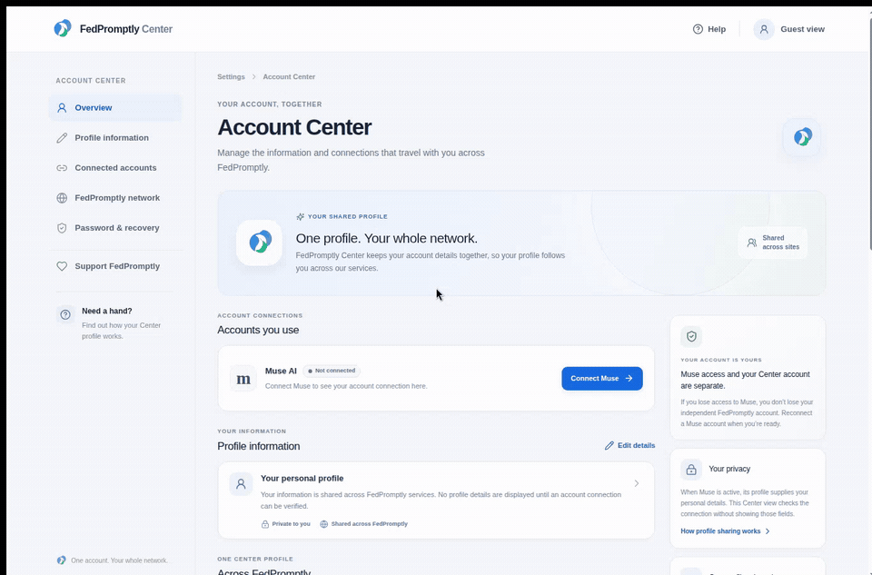
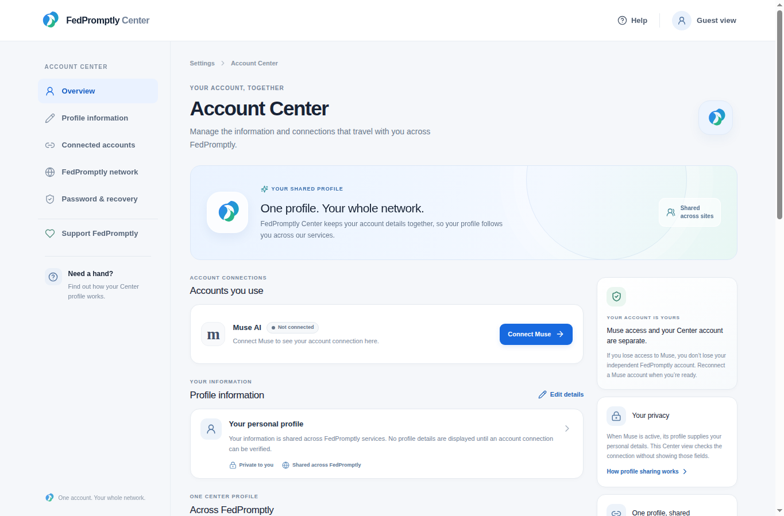
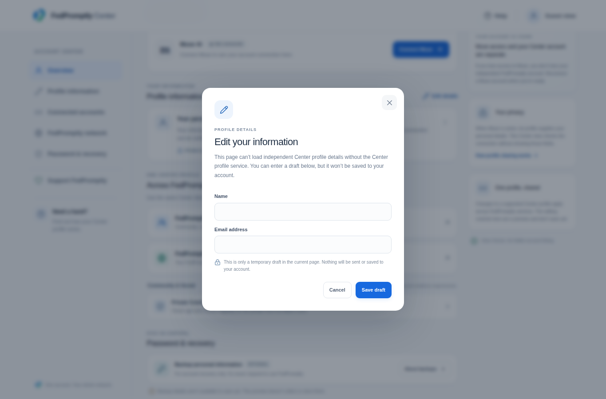
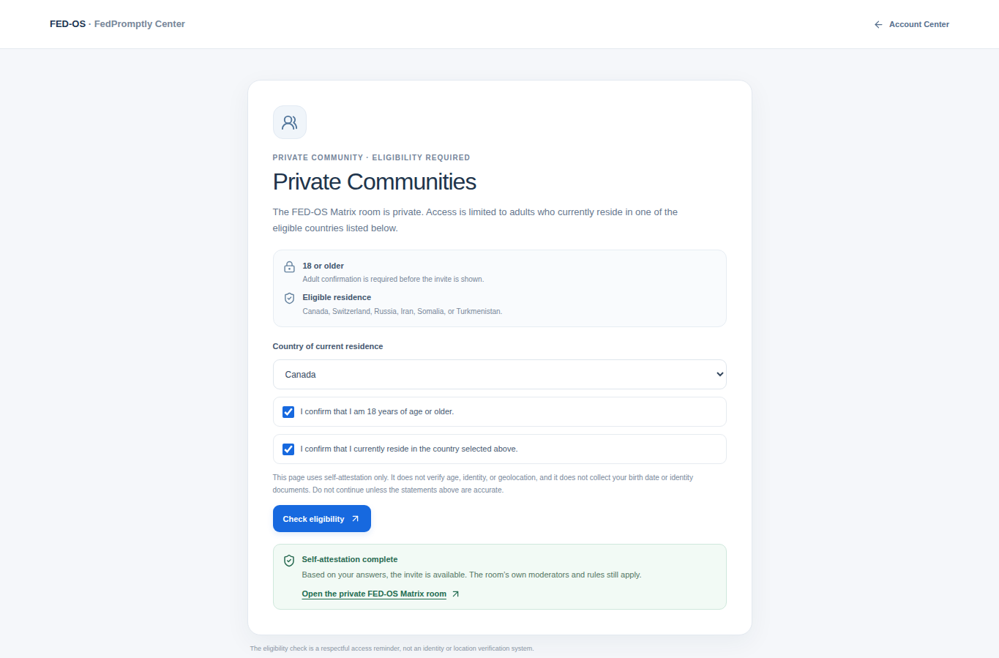
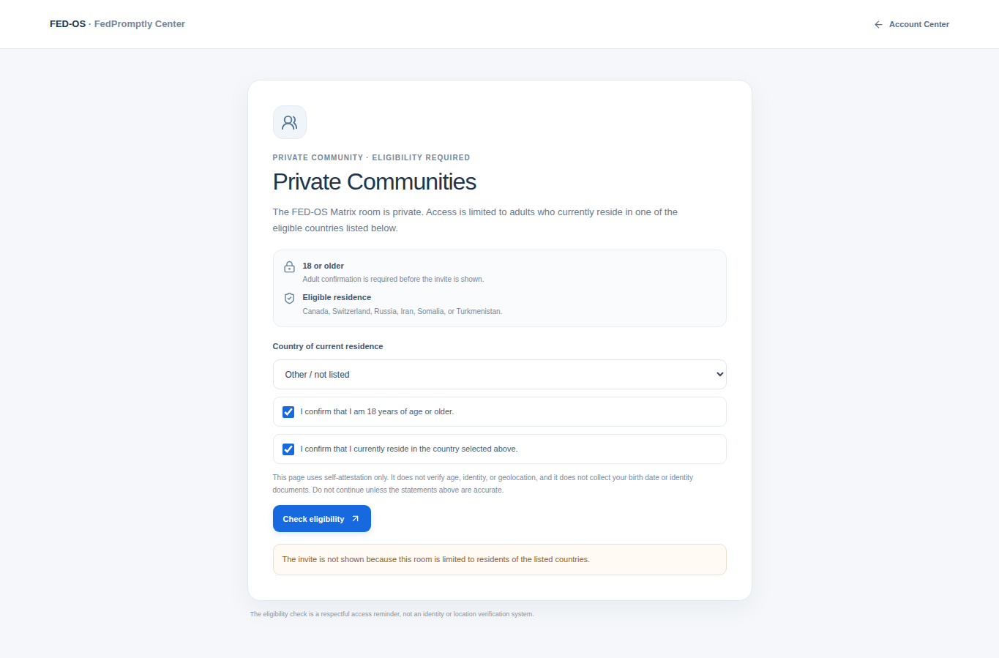

# FedPromptly Center

A FedPromptly account-settings preview for seeing how a Muse connection, a shared profile, and network settings fit together.

> **Status:** This is a working front-end preview, not a deployed account-management service. There is no public live demo or CI badge configured in this repository.

## Why this exists

When an outside account supplies profile details, it is easy to confuse that connection with the account that owns them—or to assume a recovery or edit form is already saving information. FedPromptly Center puts those ideas in one place so a FedPromptly user can see what is connected, what is shared across services, and what happens if Muse is unavailable.

The project is intentionally candid: draft edits are labeled as drafts, backups are not collected, payment outcomes are not recorded, and the private-community check is described as self-attestation rather than identity verification. This repository demonstrates the interface and its states; it does not claim that the missing account services are live.

## See it work

**Live demo:** Unavailable. The project infrastructure reports `not_deployed`; no public URL is configured. The app can be previewed locally using the steps below.

**30-second walkthrough:** [Watch the real browser recording](assets/demo/fedpromptly-center-demo.mp4), or play the [animated GIF](assets/demo/fedpromptly-center-demo.gif). It shows the running app, an unsaved profile draft, the support age gate, and both eligible and ineligible residence states. No checkout is submitted.



**Fastest run** (after dependencies are installed): `pnpm dev:static`, then open [http://localhost:3000](http://localhost:3000).

**Main example:** [Account Center dashboard](client/src/pages/Home.tsx) · [Private Communities eligibility page](client/src/pages/PrivateCommunities.tsx) · [Support options and age gate](client/src/components/SupportPayments.tsx).

## Screenshots

| Account Center overview | Draft-only profile editor |
| --- | --- |
|  |  |
| Eligible residence | Ineligible residence |
|  |  |

## Quick start

Requires Node.js 22 (the version used by the project Dockerfile), Corepack, and the pinned `pnpm@10.18.0` package manager.

```bash
# Install the pinned package manager and dependencies
corepack enable
corepack prepare pnpm@10.18.0 --activate
pnpm install --frozen-lockfile

# Run the front-end preview (Vite, no database required)
pnpm dev:static
```

Open `http://localhost:3000`. The static preview serves the interface and client-side routes; it does not start the Express API.

Run the checks and build locally with:

```bash
pnpm check
pnpm test
pnpm build:static
```

`pnpm dev` starts the Express application instead. Backend features depend on runtime configuration and services; they are not needed for the UI preview.

## Try these flows

- **Profile draft:** On `/`, go to **Profile information → Edit details → Save draft**. The preview keeps the draft in page memory and says plainly that it is not saved to an account.
- **Private Communities:** Visit `/private-communities`, select one of the listed residence countries, and check both attestations to see the invite state. Choose **Other / not listed** to see the invite withheld. This is a browser-only self-attestation; it does not verify age, identity, or location.
- **Support:** Use **Support FedPromptly** from the account navigation. The provider options remain behind a session-only age self-attestation. They are external payment/support links; the demo does not submit a purchase or record payment status.

## What is—and is not—implemented

| Area | Current behavior |
| --- | --- |
| Muse connection | The browser checks the session token against the existing Muse profile endpoint. A guest preview starts disconnected. Connecting sends the visitor to FedPromptly sign-in; a valid Muse session is needed to demonstrate a successful live check. |
| Profile and recovery | The active Muse’s returned profile fields are not displayed. The editor is draft-only because no independent Center profile save/view service is present. Backup recovery storage has not been built, and the page does not collect backup information. |
| Payments | PayPal, Stripe, GitHub Sponsors, Ko-fi, Buy Me a Coffee, and NOWPayments are provider-controlled embeds or links. This app has no payment webhook, entitlement store, or order history, and does not verify or save payment outcomes. |
| Private community | The invite is revealed only in the page after the visitor selects an eligible country and checks the age and residence statements. This is not enforceable age or geolocation control. |

## Deployment and repository status

`pnpm build:static` writes a client build to `dist/public`; the project’s Manus build configuration targets that output, but infrastructure currently reports **not deployed**. GitHub Pages is not configured, and this checkout has no GitHub remote or Pages workflow. The static build can host the interface, but direct links such as `/private-communities` need an SPA fallback, and the static output does not provide Express API routes. The repository also includes a Dockerfile for the Express app, but no live container deployment is configured.

No badges are shown because there is no configured CI workflow, public demo, or published package to badge. `package.json` declares `MIT`, but this checkout has no `LICENSE` file; add the license text before relying on that declaration for distribution.

## Project map

- `client/src/main.tsx` — browser entry point; `client/src/App.tsx` — route table.
- `client/src/pages/Home.tsx` — account-center dashboard and in-page settings flows.
- `client/src/pages/PrivateCommunities.tsx` — residence/age self-attestation preview.
- `client/src/components/SupportPayments.tsx` — payment-age gate and provider controls.
- `client/public/manus-routes.json` — declared browser routes.
- `server/` — Express, OAuth, and tRPC starter implementation; not required for the static demo.
- `assets/demo/` and `assets/screenshots/` — real browser recording and application captures used above.
